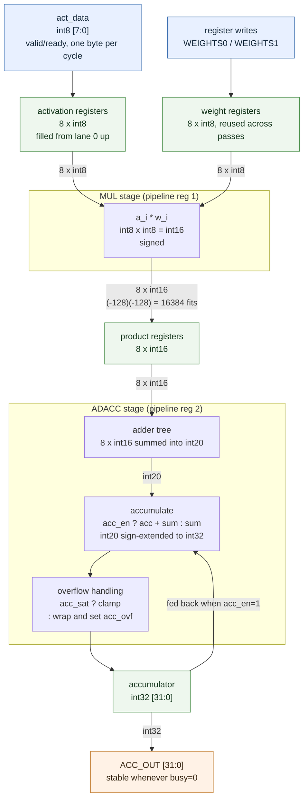
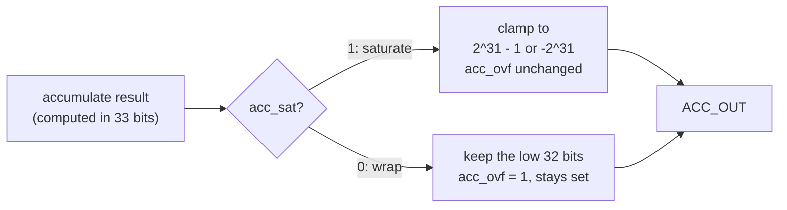
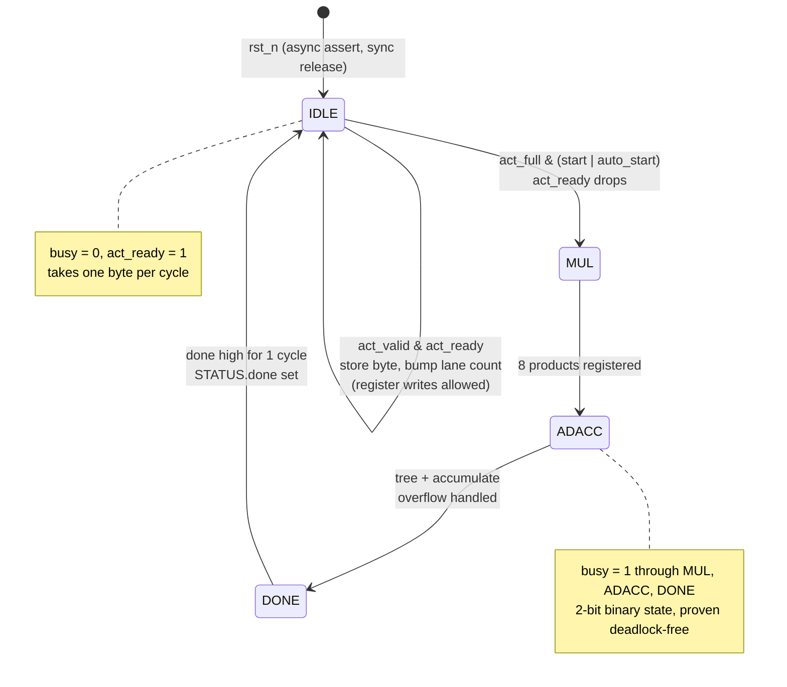
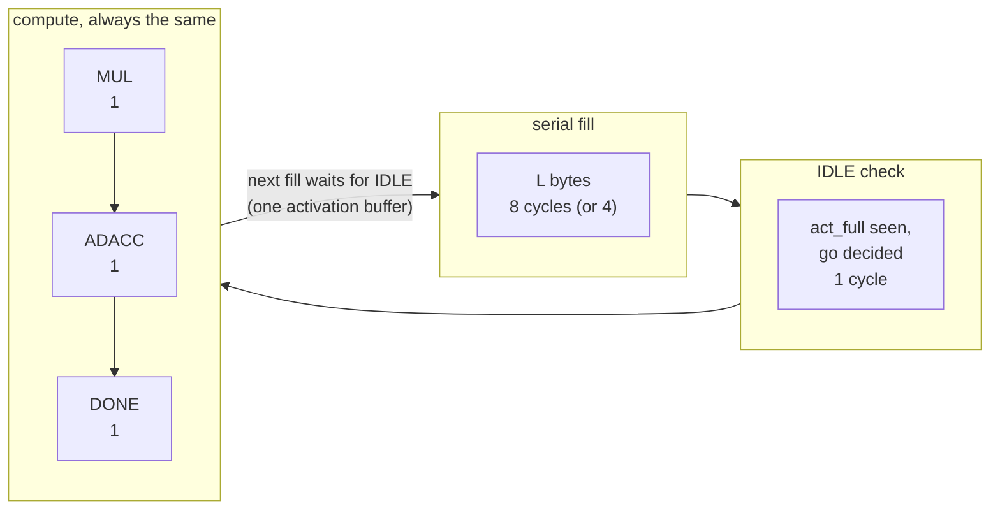
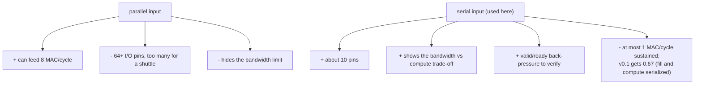
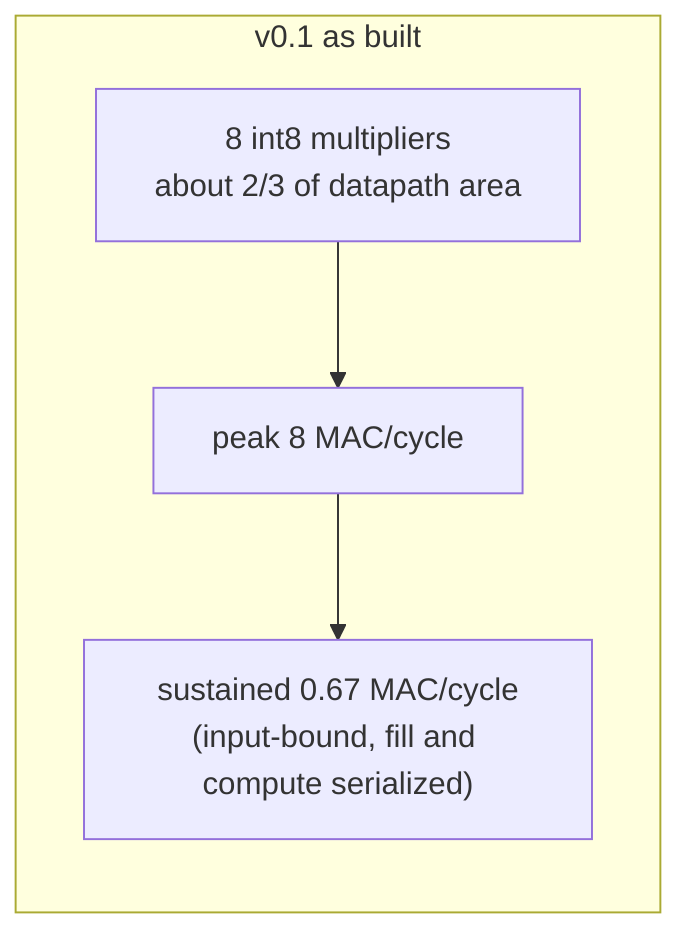

# MACC-8 block diagram and microarchitecture

This goes with `int8_mac_design_spec.md`. It covers bit widths, signedness,
overflow, latency, and why the activation input is serial and what that
costs in throughput.

---

## 1. Datapath

**Signed arithmetic.** Everything is two's complement. An int8 times an int8
always fits in int16; the worst case, -128 × -128 = 16384, has plenty of
room. The adder tree sign-extends each product and works in 20 bits, so
eight products can't overflow inside a pass (8 × 2^15 is less than 2^19).
The tree output is then sign-extended to 32 bits for the accumulator. The
datapath is signed × signed only. `CONFIG.act_signed` and `wt_signed` can be
written and read back, but in v0.1 they don't change anything.

**Overflow and saturation.** The only place overflow can happen is the
int32 accumulator, after many accumulating passes. `CONFIG.acc_sat` picks
what happens:

The add is done in 33 bits only so the signed carry-out can be seen. What
gets stored is always 32 bits.

---

## 2. Control FSM and latency

**Latency** in `clk` cycles, assuming the weights are already loaded:

| Operation | Cycles |
|---|---|
| `start` to `done`, vector already loaded | **3** (MUL, ADACC, DONE) |
| one chunk including the fill, `auto_start=1` | `L + 4`: **12** with 8 lanes, **8** with 4 |
| length-`K` dot product, `M = K/L` chunks in a row | `M·(L + 4)`, since fill and compute don't overlap |

Compute time never depends on the data, which makes scheduling easy. The
total is dominated by the `L`-cycle fill, which is what the next two
sections are about. The extra cycle in `L + 4` is the IDLE cycle where the
FSM first sees the registered `act_full`. Fill and compute can't overlap
because `act_ready` is only high in IDLE and there's a single activation
buffer (`rtl/macc8_serial_rx.sv`).

---

## 3. Why the input is serial

A parallel port would take all `L` activations (and maybe the weights) in
one cycle. I went with one byte at a time instead, for these reasons:

- **Pins.** A parallel 8-lane activation port is 64 data pins plus
  handshake. On Caravel or TinyTapeout, GPIO is the thing you run out of
  first. The serial port needs about 10 pins (8 data plus valid/ready). For
  a shuttle tapeout, pins are the limiting resource, not gates.
- **It's how real accelerators behave.** Production engines are rarely
  short on multipliers; they're short on operand bandwidth from memory or
  the NoC. A serial front end puts that bottleneck in plain view in a small
  design, which makes it easy to measure and talk about.
- **A real handshake to verify.** valid/ready means real back-pressure,
  stalls, and protocol properties to prove, which carry over to other
  blocks.
- **Weights stay put.** Weights are written through registers and reused,
  so only activations stream in. The serial cost is paid once per
  activation vector, not once per MAC.

The price is lower sustained throughput. The next section puts numbers on
it, and fixing it is the main goal for v0.2.

---

## 4. Area versus throughput

The 8-lane array can do 8 MACs per cycle, but the serial port delivers at
most one byte per cycle, so at most one MAC per cycle. v0.1 only gets
`L/(L+4)`, about 0.67, because filling and computing take turns. In steady
state roughly 11 out of every 12 multiplier-cycles do nothing useful.

| Option | Multipliers | Peak MAC/cycle | Sustained MAC/cycle | Area | Utilization |
|---|---|---|---|---|---|
| 8 lanes (v0.1) | 8 | 8 | 0.67 (8/12) | high | ~8% |
| 4 lanes (`lane_sel=0`, v0.1) | 4 used | 4 | 0.5 (4/8) | high (same netlist, lanes 4-7 masked, still there) | ~12% |
| 8 lanes + ping-pong activation buffer (v0.2) | 8 | 8 | ~1 | high + 64 flops | ~12% |
| **one shared multiplier (v0.2)** | 1 | 1 | ~1 (MAC as each byte arrives) | **low** | **~100%** |
| wider input + 8 lanes + ping-pong (v0.2) | 8 | 8 | ~8 | high, plus pins | ~100% |

**What the table says.** With one byte per cycle coming in, paying for 8
multipliers buys a peak number you can never sustain. There are two sensible
ways out:

1. **Shrink the compute to match the input.** Time-share 1 or 2 multipliers
   across the 8 lanes. Throughput stays around 1 MAC/cycle, utilization goes
   to nearly 100%, and multiplier area drops by about 8×. This is the most
   area-efficient option for this input width.
2. **Widen the input to match the compute.** A multi-byte port, or loading
   weights and activations in parallel, pushes sustained throughput toward 8
   MAC/cycle, and then the 8 multipliers pay for themselves. This is the
   fastest option, at the pin and area cost from section 3.

For sustained work, v0.1's 8 parallel lanes are the worst choice on this
list. I built it that way to make the trade-off concrete, and to have the
full multiplier array and adder tree in the RTL and the tests. The design is
parameterized (`LANES` now, a `MUL_SHARE` factor planned), so every row
above is meant to be the same source code with different parameters. That
way PPA becomes a setting you change, not a rewrite.
